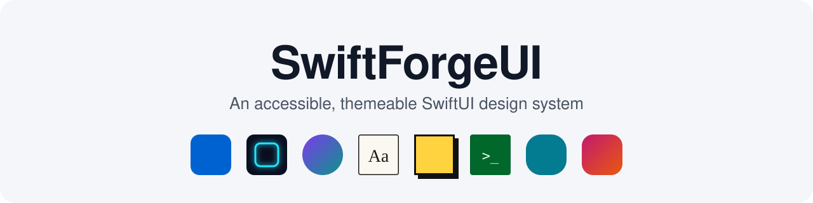
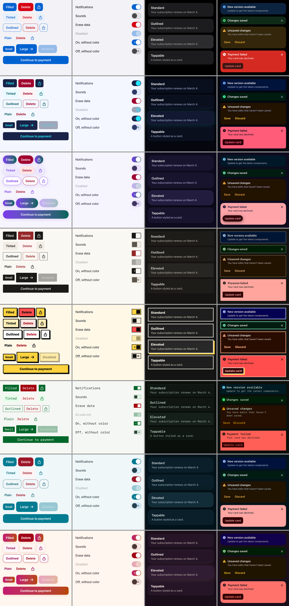
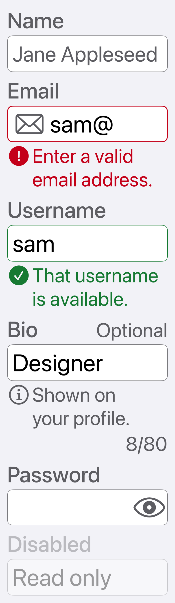
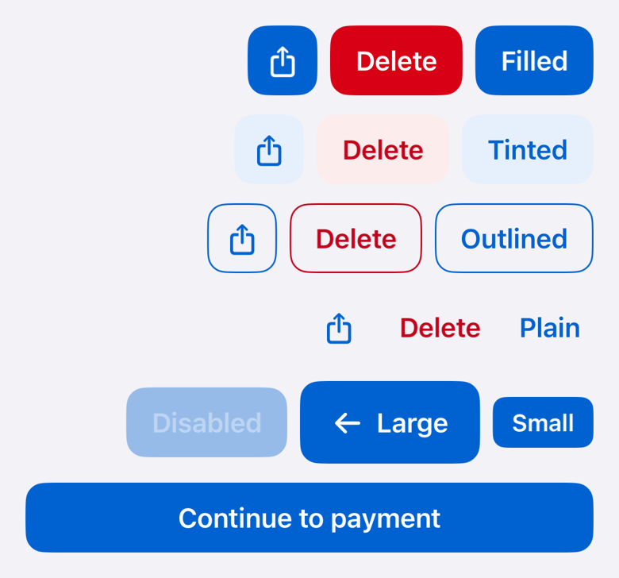
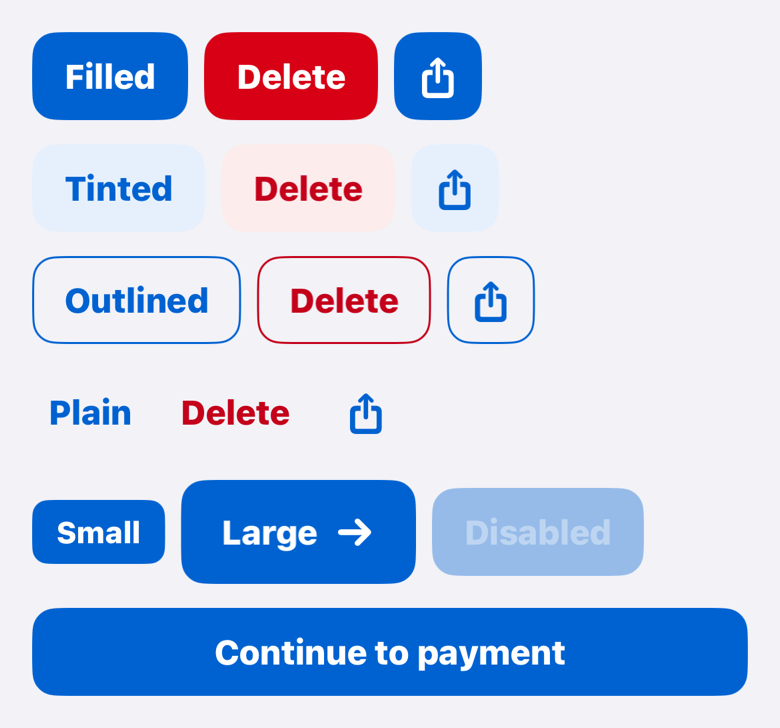
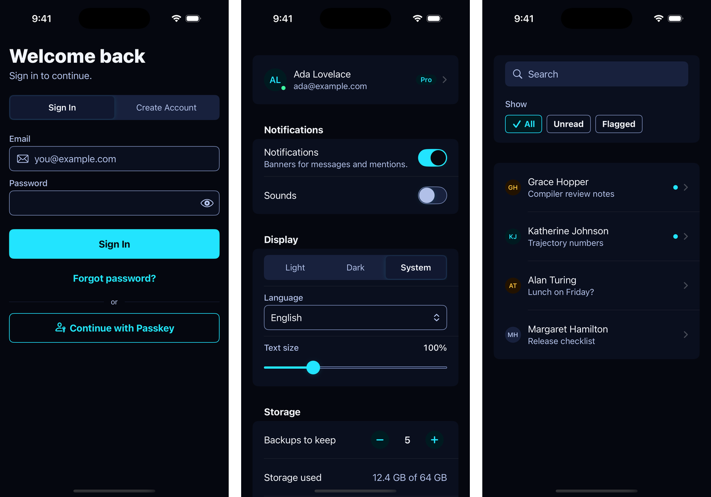
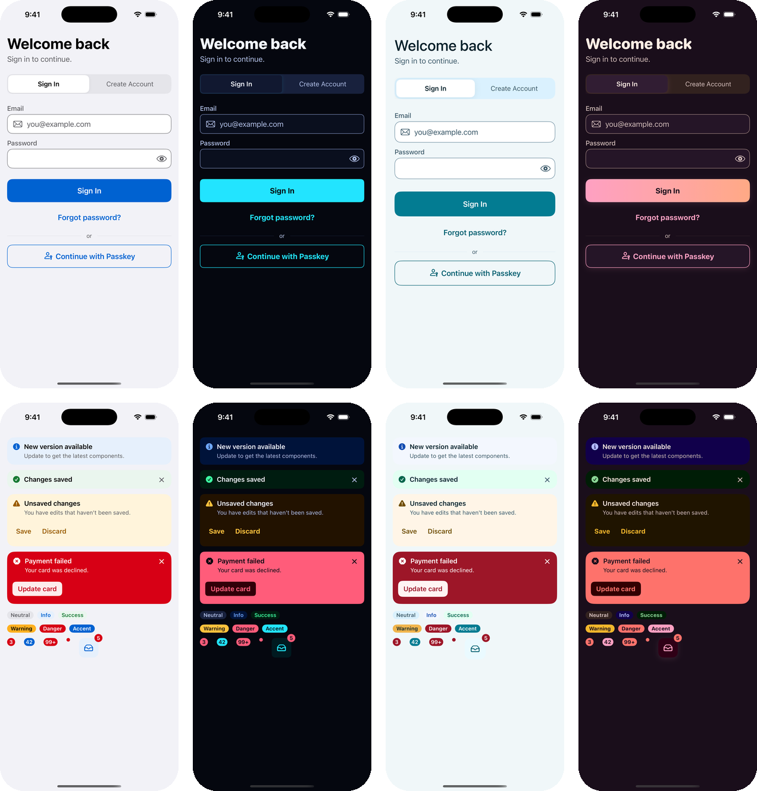

<p align="center">
  
</p>

# SwiftForgeUI

[](https://github.com/HelloSamet/SwiftForgeUI/actions/workflows/ci.yml)
[](https://hellosamet.github.io/SwiftForgeUI/documentation/swiftforgeui/)


[](https://www.swift.org/documentation/package-manager/)
[](LICENSE)

An accessible, themeable SwiftUI design system that speaks SwiftUI's own language.

SwiftForgeUI styles native SwiftUI controls with a coherent set of design tokens and adds the components SwiftUI
doesn't provide. Eight built-in themes change not just color but shape, depth, density, and typography — with one
line. Accessibility isn't an option you turn on: every theme meets WCAG 2.2 AA contrast in light, dark, and Increase
Contrast — and the test suite proves it on every run.

```swift
import SwiftForgeUI

@main struct MyApp: App {
    var body: some Scene { WindowGroup { ContentView().swiftForgeTheme(.midnight) } }
}
// Then, anywhere: Button("Save") { }.buttonStyle(.swiftForge())
```



| Accessibility 5 | Right-to-left | Bold Text |
|---|---|---|
|  |  |  |

*These images are reference snapshots from the test suite, not mock-ups.*

## Why SwiftForgeUI

- **Native first.** Buttons are SwiftUI `Button`s with a style; size comes from `controlSize`, destructive styling
  from `role`. Your `Menu`, `NavigationLink`, and `ShareLink` get the same look. You don't learn a parallel API.
- **Themes with character.** Eight built-in themes, your own in a few lines, any theme scoped to part of a screen, and
  runtime switching that remembers the choice and animates the change. Components never hardcode a visual value.
- **Accessible by construction.** AA contrast in every appearance, Dynamic Type through `accessibility5`, 44 pt hit
  areas, VoiceOver labels that match what's on screen, localized library strings, Reduce Motion and right-to-left
  support — each verified by automated tests.
- **Zero dependencies.** Pure SwiftUI. No networking, analytics, or telemetry.

## Requirements

- iOS 17.0+ or visionOS 1.0+
- Xcode 16.4+ (Swift 6)

SwiftForgeUI builds for visionOS, but its components haven't yet been tested or design-reviewed there — expect
iPhone-and-iPad styling. macOS isn't supported yet.

## Installation

In Xcode, choose **File › Add Package Dependencies…** and enter `https://github.com/HelloSamet/SwiftForgeUI.git`, or add
it to `Package.swift`:

```swift
.package(url: "https://github.com/HelloSamet/SwiftForgeUI.git", from: "0.2.0")
```

## Quick start

```swift
import SwiftForgeUI
import SwiftUI

@main
struct MyApp: App {
    var body: some Scene {
        WindowGroup {
            SignInView()
                .swiftForgeTheme(.midnight)   // or .forge, .ocean, .sunset, .aurora, …, or your own
        }
    }
}

struct SignInView: View {
    @State private var email = ""
    @State private var password = ""
    @Environment(\.swiftForgeTheme) private var theme

    var body: some View {
        VStack(spacing: theme.spacing.component) {
            SwiftForgeTextField("Email", text: $email, prompt: Text("you@example.com")) {
                Image(systemName: "envelope")
            }
            .textContentType(.username)

            SwiftForgeSecureField("Password", text: $password)
                .textContentType(.password)

            SwiftForgeButton("Sign In") {               // shows loading, ignores repeat taps
                try await session.signIn(email: email, password: password)
            }
            .controlSize(.large)

            Button("Forgot password?") { showReset() }
                .buttonStyle(.swiftForge(.plain))
        }
        .swiftForgeFullWidth()
        .padding(theme.spacing.screenHorizontal)
    }
}
```

## Components

| Category | API |
|---|---|
| **Actions** | `.buttonStyle(.swiftForge(.filled / .tinted / .outlined / .plain, tone:))` · `.buttonStyle(.swiftForgeIcon(…))` · `SwiftForgeButton` (async) · `.toggleStyle(.swiftForge)` · `.toggleStyle(.swiftForgeCheckbox)` (with mixed state) · `SwiftForgeChip` · `SwiftForgeChipGroup` · `SwiftForgeSegmentedControl` |
| **Inputs & forms** | `SwiftForgeTextField` · `SwiftForgeSecureField` (+ `.swiftForgePasswordStrength(_:)`) · `SwiftForgeTextArea` · `SwiftForgeSearchField` · `SwiftForgePicker` · `SwiftForgeRadioGroup` · `SwiftForgeSlider` · `SwiftForgeRangeSlider` · `SwiftForgeStepper` · `SwiftForgeOTPField` |
| **Display** | `SwiftForgeCard` (header, footer, `.groupBoxStyle(.swiftForgeCard(_:))`) · `SwiftForgeListRow` · `SwiftForgeSectionHeader` · `.swiftForgeListStyle()` · `SwiftForgeAvatar` · `SwiftForgeAvatarGroup` · `SwiftForgeBadge` · `SwiftForgeRating` · `SwiftForgeDivider` · `.disclosureGroupStyle(.swiftForge)` · `.progressViewStyle(.swiftForgeLinear / .swiftForgeCircular)` · `.swiftForgeSkeleton(isActive:)` · `SwiftForgeEmptyState` |
| **Feedback & overlays** | `SwiftForgeBanner` · `SwiftForgePresenter` with `SwiftForgeToast` and `SwiftForgeAlertDialog` · `.swiftForgeBottomSheet(isPresented:)` · `.swiftForgeTooltip(_:isPresented:)` · `.swiftForgeLoadingOverlay(isPresented:)` |
| **Navigation** | `SwiftForgeTabBar` · `SwiftForgeNavigationHeader` |
| **Screens** | `.swiftForgeScreen()` · `.swiftForgeTextStyle(_:color:)` · `SwiftForgeDensity` |
| **Customization** | Native style protocols, plus `SwiftForgeFieldStyle`, `SwiftForgeChipStyle`, `SwiftForgeSegmentedControlStyle`, and `SwiftForgeTabBarStyle` |
| **Theming** | `SwiftForgeTheme` (`.forge`, `.midnight`, `.aurora`, `.paper`, `.neoBrutal`, `.mono`, `.ocean`, `.sunset`) · `SwiftForgeThemeManager` · component tokens · `SwiftForgeContrastAudit` |
| **Foundations** | Color, typography, spacing, radius, size, border, elevation, opacity, motion, and haptics tokens · `SwiftForgeShape` · `SwiftForgeFill` |

Every component is listed with its accessibility behavior in the *Component Catalog* documentation article.

## Theming

| Theme | Character |
|---|---|
| `.forge` | The default: balanced, iOS-native, soft corners |
| `.midnight` | Dark-first, high contrast, neon accents, accent glow |
| `.aurora` | Gradient pill buttons, glass overlays, SF Rounded, bouncy motion |
| `.paper` | Ink on paper, serif headings, hairlines, no shadows |
| `.neoBrutal` | Square corners, thick outlines, hard shadows controls sink into |
| `.mono` | SF Mono, one phosphor accent, dense layout with 44-pt hit areas |
| `.ocean` | Lagoon teal, pebble-rounded corners, soft sea-tinted shadows, calm motion |
| `.sunset` | Magenta-to-ember gradient buttons, warm glow, heavy rounded headings |

Scope a theme to any subtree — the innermost wins — or let people choose one; the choice is restored before the first
frame and changes animate (instantly with Reduce Motion):

```swift
@State private var themes = SwiftForgeThemeManager()             // persists to UserDefaults
ContentView().swiftForgeTheme(themes)                            // read it with @Environment(SwiftForgeThemeManager.self)
```

Your own theme is a value — no changes to the package:

```swift
extension SwiftForgeTheme {
    static let acme = SwiftForgeTheme(id: "acme", displayName: "Acme", basedOn: .forge) { theme in
        theme.colors.accent = .derived(from: SwiftForgeColor(light: 0x5B3CC4, dark: 0x7B61E0), on: theme.colors)
        theme.components.button.cornerRadius = SwiftForgeRadius.capsule
        theme.typography.title1 = theme.typography.title1.designed(.serif)
    }
}

@Test func acmeIsAccessible() {
    #expect(SwiftForgeContrastAudit.run(on: .acme).isEmpty)
}
```

## Accessibility

| Guarantee | How it's verified |
|---|---|
| WCAG AA contrast in every theme, in light, dark, and both Increase Contrast appearances | Contrast audit unit tests, and Apple's accessibility audit in every theme in light and dark mode |
| Dynamic Type through `accessibility5` without clipping | Snapshot tests at AX5 and Apple's `performAccessibilityAudit()` |
| 44 × 44 pt hit areas, even for small buttons | Rendering tests, UI tests, accessibility audit |
| VoiceOver labels match visible labels; banners read as one sentence; badges become values | UI tests |
| Loading and disabled buttons ignore taps; async buttons never run twice | UI tests |
| Library strings localized (English, Turkish) and follow the environment locale | Unit and UI tests |
| Bold Text, Reduce Motion, Reduce Transparency, Differentiate Without Color, Button Shapes, right-to-left | Unit, rendering, and snapshot tests |

Preview any screen under these settings — which SwiftUI doesn't let you set directly — with
`.swiftForgeAccessibilitySimulation(increasedContrast:reduceMotion:reduceTransparency:differentiateWithoutColor:)`.

## Showcase app

`Examples/SwiftForgeShowcase/SwiftForgeShowcase.xcodeproj` is a live catalog of every component with controls for
theme, appearance, Dynamic Type, layout direction, library language, and accessibility simulation, plus a theme
gallery, a side-by-side theme comparison, and a state matrix. Three example screens — sign-in and sign-up, settings,
and an inbox with a detail screen — are built only from SwiftForgeUI, and a stress page scrolls 500 mixed rows for
profiling. The project also hosts the snapshot, accessibility, UI, and performance test suites.



## Screenshots

The sign-in example and the feedback components in Forge (light), Midnight (dark), Ocean (light), and Sunset (dark),
captured from the Showcase app on an iPhone 16 Pro:



## Documentation

- **[API reference and articles](https://hellosamet.github.io/SwiftForgeUI/documentation/swiftforgeui/)** —
  Getting Started, Design Principles, Component Catalog, Introducing Themes, Creating a Custom Theme, Token Reference,
  Writing a Custom Component Style, and Accessibility. In Xcode: **Product › Build Documentation**.
- Theme colors and contrast ratios: [docs/design/themes](docs/design/themes), generated by
  [scripts/theme-design](scripts/theme-design/README.md)
- Architecture and decision log: [docs/ARCHITECTURE.md](docs/ARCHITECTURE.md)

## Development

```bash
# Package unit tests (iOS Simulator; the package is iOS/visionOS-only, so `swift test` doesn't apply)
xcodebuild test -scheme SwiftForgeUI -destination 'platform=iOS Simulator,name=iPhone 16'

# Snapshot, accessibility, and UI tests: iOS 18, and a Pro Max so the audited fixtures fit on screen.
# The reference images live in a separate repository; fetch them first.
scripts/snapshots.sh fetch
xcodebuild test -project Examples/SwiftForgeShowcase/SwiftForgeShowcase.xcodeproj -scheme SwiftForgeShowcase \
  -destination 'platform=iOS Simulator,name=iPhone 16 Pro Max'

# Scrolling performance, on demand (Release)
TEST_RUNNER_SWIFTFORGE_PERF=1 xcodebuild test -project Examples/SwiftForgeShowcase/SwiftForgeShowcase.xcodeproj \
  -scheme SwiftForgeShowcase -configuration Release ENABLE_TESTABILITY=YES \
  -destination 'platform=iOS Simulator,name=iPhone 16 Pro Max' -only-testing:UITests/ScrollPerformanceTests

# Lint
swift format lint --strict --recursive Sources Tests Examples
scripts/lint-design-tokens.sh

# Documentation website, in .build/docs
scripts/build-docs.sh
```

See [CONTRIBUTING.md](CONTRIBUTING.md) for the full workflow, including recording snapshots.

## Roadmap

- **0.9.0 — release candidate:** API freeze; a manual tour with
  VoiceOver, Voice Control, Switch Control, and Full Keyboard Access; iPad layouts and pointer hover effects under
  test; and an on-device Instruments pass.
- **1.0.0:** two weeks of release candidate without breaking changes.
- **Candidates for 1.x:** a date picker style, step and page indicators, a menu style, a visionOS design pass,
  macOS, a Liquid Glass surface style on iOS 26, and importing tokens from JSON (Figma Tokens).

Have a use case that isn't covered? [Open a feature request](https://github.com/HelloSamet/SwiftForgeUI/issues/new/choose).

## Contributing

Bug reports, fixes, translations, and component proposals are welcome — start with
[CONTRIBUTING.md](CONTRIBUTING.md). Everyone taking part follows the [Code of Conduct](CODE_OF_CONDUCT.md). To
report a security issue, see [SECURITY.md](SECURITY.md).

## Versioning

SwiftForgeUI follows [Semantic Versioning](https://semver.org). Until 1.0, minor versions may contain breaking
changes, each listed with a migration path in [CHANGELOG.md](CHANGELOG.md). See [RELEASING.md](RELEASING.md) for how
releases are made.

## License

MIT. See [LICENSE](LICENSE).
